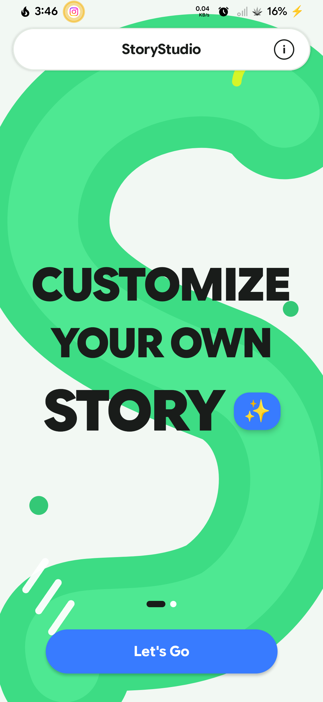
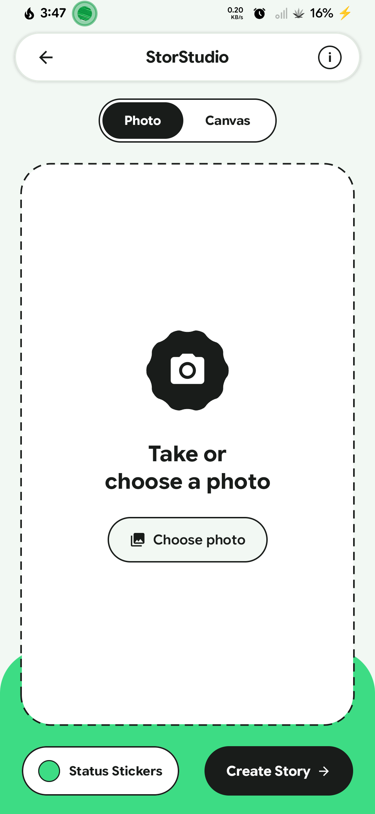
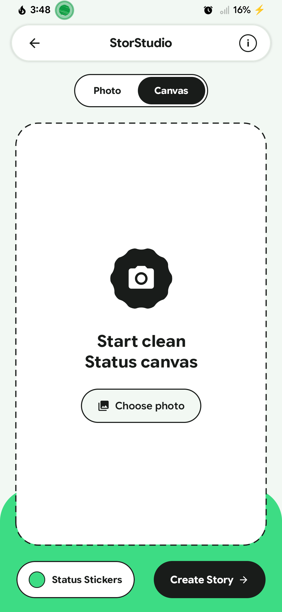
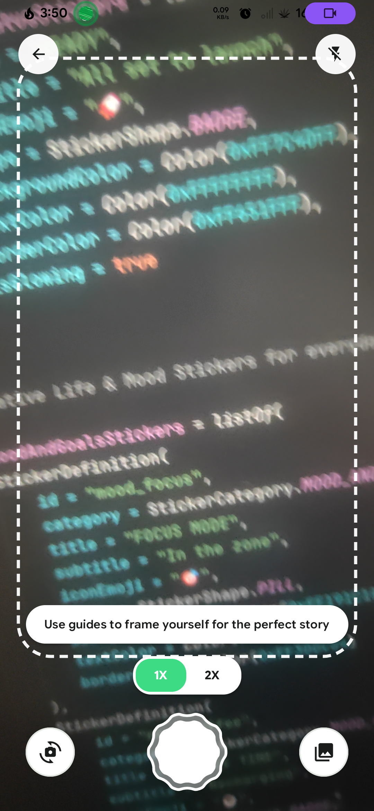
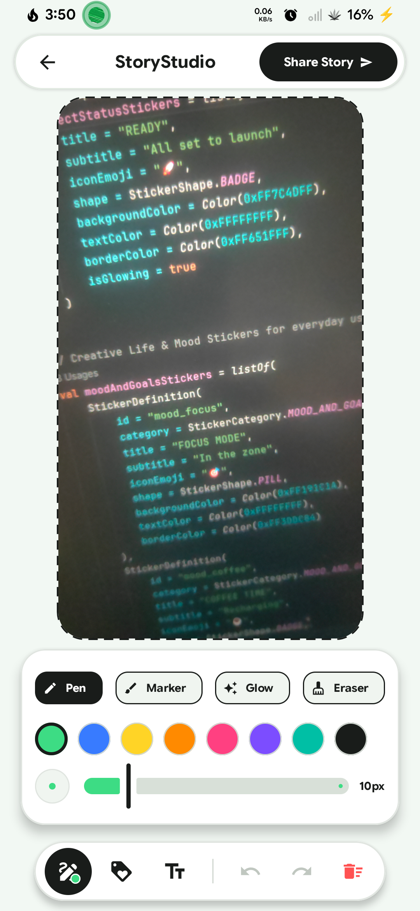
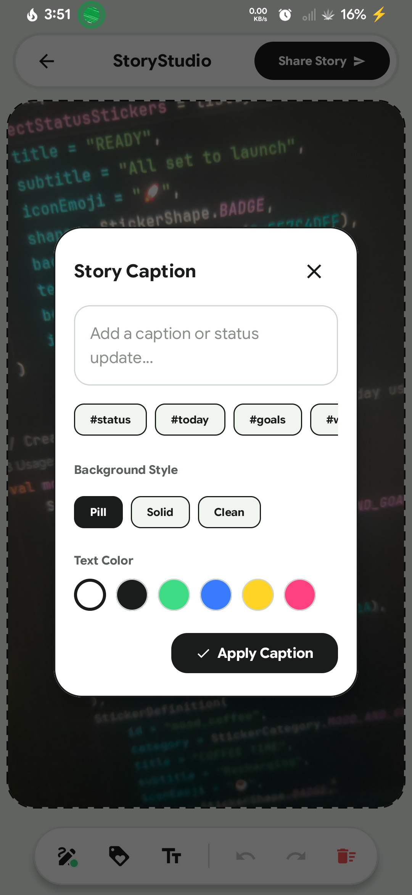
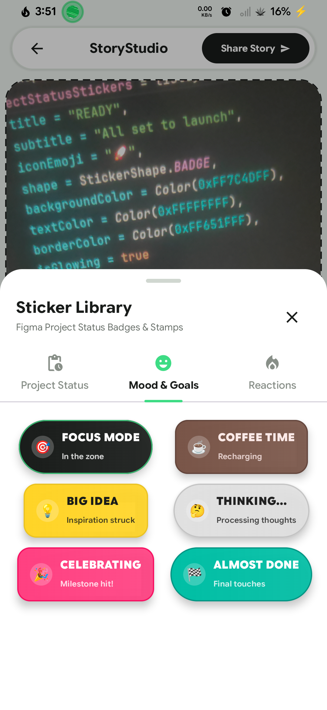

# StoryStudio 🎨✨

> **Interactive Photo & Status Canvas for Android** — Built with Jetpack Compose, Material 3 Expressive styling, CameraX viewfinder, freehand vector drawing, Figma-style project status stickers, and direct Instagram Stories integration.

---

## 📸 App Screenshots

Explore StoryStudio in action across its core creation pipeline:

| Hub & Mode Selector | Camera Viewfinder | Story Canvas & Drawing |
| :---: | :---: | :---: |
|  |  |  |
| **Dual Creation Hub** | **Live Camera & Zoom** | **Vector Canvas & Tools** |

| Sticker Library | Caption Editor | Instagram Share & Export |
| :---: | :---: | :---: |
|  |  |  |
| **Project Status Badges** | **Live Caption Styles** | **Direct Social Dispatch** |

| Additional Flow | | |
| :---: | :---: | :---: |
|  | | |
| **Workflow Overview** | | |

---

## 📑 Table of Contents

- [Overview](#-overview)
- [Key Features](#-key-features)
- [App Workflow](#-app-workflow)
- [Instagram Stories Integration & Limitations](#-instagram-stories-integration--limitations)
- [Technology Stack](#-technology-stack)
- [Architecture & Project Structure](#-architecture--project-structure)
- [Setup & Build Instructions](#-setup--build-instructions)
- [Permissions & Privacy](#-permissions--privacy)
- [Known Limitations & Troubleshooting](#-known-limitations--troubleshooting)
- [License](#-license)

---

## 🌟 Overview

**StoryStudio** is a modern, feature-rich Android application designed for creators, developers, and professionals who want to craft polished, expressive visual status updates and stories on the go. Featuring a distinctive **Material 3 Expressive** design system (`AndroidifyPaleMint`, `AndroidifyGreen`, `AndroidifyBlack`, scalloped UI shapes, and pill navigation), StoryStudio provides a seamless creative pipeline from live camera capture to social sharing.

---

## ✨ Key Features

### 1. Hub & Dual Creation Modes
- **Photo Mode**: Instantly capture live photos or select existing images from your device gallery using modern system photo pickers (`PickVisualMedia`).
- **Canvas Mode**: Start with a clean, beautifully styled gradient status canvas for text- and sticker-driven announcements.

### 2. CameraX Viewfinder & Controls
- Built on Jetpack **CameraX** (`camera-camera2`, `camera-lifecycle`, `camera-view`).
- **Quick Controls**: Toggle flash/torch, flip between front and rear cameras, and toggle 1X / 2X zoom levels with animated pill selectors.
- **Permission Flow**: Graceful fallback handling with `CameraPermissionView` for missing permissions and direct gallery picker access.

### 3. Rich Creative Canvas
- **Freehand Vector Drawing**: Four distinct brush styles (Pen, Highlighter with 45% alpha, Neon Glow with multi-pass outer glow, and Eraser) with dynamic color palettes and stroke width sliders.
- **Rock-Solid Undo/Redo**: Comprehensive history manager supporting stroke additions, sticker transformations, deletions, and canvas clears.
- **Interactive Sticker Library**: Figma-inspired project status badges, mood/goal stickers, and reaction stamps (`StickerSheet`) with touch-based translation, pinch zoom, rotation, duplication, and deletion.
- **Live Caption Banners**: Customizable caption text supporting 4 distinct styling presets: Rounded Pill, Solid Block, Outline, and Transparent.

---

## 🔄 App Workflow

```
[ Onboarding / Splash ]
         │
         ▼
[ Hub Screen ] ──(Photo or Canvas)──► [ Camera Viewfinder / Gallery Picker ]
                                                 │
                                                 ▼
                                     [ Story Canvas Screen ]
                                        • Freehand Drawing
                                        • Status Stickers
                                        • Live Caption
                                                 │
                                                 ▼
                                     [ Composite Story Exporter ]
                                                 │
                                                 ▼
                                     [ Direct Instagram Share ]
```

1. **Capture / Select**: Choose between snapping a photo with the live CameraX viewfinder or selecting an image from the gallery.
2. **Draw & Add Stickers**: Express thoughts with multi-style freehand strokes and attach professional project status badges.
3. **Caption**: Add punchy captions with custom typography backgrounds.
4. **Preview & Export**: Composite the base photo, vector paths, stickers, and captions into a high-res 1080×1920 PNG story image via `StoryExporter` and `FileProvider`.
5. **Share**: Instantly dispatch the rendered story to Instagram Stories with one tap.

---

## 🚀 Instagram Stories Integration & Platform Limitations

StoryStudio implements direct integration with **Instagram Stories** via Android Intents (`com.instagram.share.ADD_TO_STORY`):

- **Single Asset Dispatch**: Passes the composite story URI as `image/png` to avoid duplicate background display issues in Instagram.
- **Caption Clipboard Fallback**: Because Instagram's third-party story sharing intent does not support arbitrary text box prefill natively, StoryStudio automatically copies your caption text to the device clipboard upon sharing, allowing you to instantly paste it into Instagram's native text tool.
- **Graceful Fallback**: If Instagram is not installed on the device, the `InstagramMissingDialog` intercepts the action and provides a one-tap redirect to the Google Play Store (`market://details?id=com.instagram.android`).

---

## 🛠 Technology Stack

- **UI Toolkit**: Jetpack Compose (BOM `2024.09.00`) with Material 3 and Material 3 Expressive customizations.
- **Camera**: Android CameraX (`1.5.0`) for high-performance lifecycle-aware viewfinder preview and image capture.
- **Image Loading**: Coil Compose (`2.7.0`) for efficient asynchronous image loading.
- **Concurrency**: Kotlin Coroutines & Flow (`1.10.2`) for asynchronous composition and background rendering.
- **File Sharing**: AndroidX Core `FileProvider` for secure content URI sharing.
- **Testing**: JUnit 4, AndroidX JUnit, Espresso, Robolectric (`4.16.1`), and Compose UI Test manifest.

---

## 📂 Architecture & Project Structure

The project follows a clean, modular structure centered around single-activity unidirectional state management:

```
com.example/
├── MainActivity.kt                # Single Activity & Animated Nav Host
├── camera/                        # CameraX controller, preview, and permissions
├── canvas/                        # Drawing canvas, history manager, caption modal, toolbar
├── export/                        # Story compositing engine & Instagram share helper
├── model/                         # Data classes (DrawPath, CanvasSticker, StoryCaption)
├── stickers/                      # Sticker repository, badge view, and sticker drawer sheet
└── ui/                            # Composable screens (Hub, Camera, Canvas, Onboarding, Dialogs)
```

---

## ⚙️ Setup & Build Instructions

### Prerequisites
- **Android Studio**: Ladybug / Meerkat or newer.
- **JDK**: Java 11 or higher.
- **Android SDK**: Compile SDK 36, Min SDK 24 (`targetSdk 36`).

### Cloning & Opening
1. Clone the repository:
   ```bash
   git clone https://github.com/your-username/StoryStudio.git
   ```
2. Open the project folder in Android Studio.
3. Allow Gradle to sync dependencies.

### Verified Gradle Commands
Run tests and builds directly from your terminal:

- **Run Unit Tests**:
  ```bash
  ./gradlew app:testDebugUnitTest
  ```
- **Build Debug APK**:
  ```bash
  ./gradlew app:assembleDebug
  ```

---

## 🔒 Permissions & Privacy

- **Camera (`android.permission.CAMERA`)**: Required solely for capturing live story photos within the CameraX viewfinder. Declared as optional (`android.required="false"`), allowing gallery-only usage on emulator or unsupported camera hardware.
- **Local-First Processing**: All story compositing, drawing, and sticker rendering happen entirely on-device in the app cache directory. No user photos or stories are uploaded to external tracking servers.

---

## ⚠️ Known Limitations & Troubleshooting

1. **Instagram App Requirement**: Direct story sharing requires the official Instagram Android app (`com.instagram.android`) to be installed on the device.
2. **Emulator Camera Preview**: Android emulators may require virtual webcam configuration or fallback to photo picker selection if physical camera hardware is unavailable.
3. **Export Caching**: Rendered story PNGs are stored in `context.cacheDir/images` and shared securely via `FileProvider`. Cached temporary files are periodically cleaned up by the system.

---

## 📄 License

Distributed under the MIT License. See [LICENSE](LICENSE) for more information.
